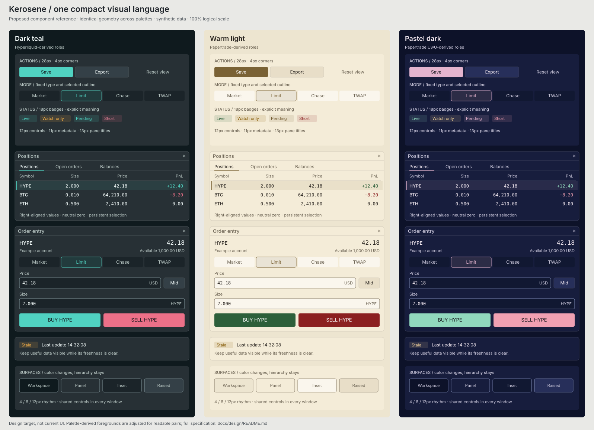

# Kerosene Design Language

Kerosene should feel like one compact trading terminal across every theme:
quiet surfaces, precise alignment, readable market data, and controls whose
appearance consistently communicates their purpose and state. Themes supply
color and atmosphere. Component geometry, hierarchy, and behavior stay the same.

This is the target specification for an application-wide visual consistency
pass. It preserves the compact terminal direction confirmed by the project
owner, with no reference theme elevated above the others. The specific sizes,
recipes, and examples below are proposed design decisions. They are not a claim
that the current application already implements them. Application behavior and
source code are unchanged by this documentation.

## Read the system

| Guide | What it decides |
| --- | --- |
| [Foundations and themes](foundations.md) | Color roles, theme adaptation, typography, spacing, density, corners, icons, contrast, and motion. |
| [Component specifications](components.md) | Buttons and their states, inputs, selectors, tabs, menus, tables, badges, feedback, and overlays. |
| [Screen patterns](patterns.md) | How those components compose into panes, charts, order tickets, account tables, feeds, settings, and auxiliary windows. |
| [Current application audit](audit.md) | Concrete source-backed inconsistencies, existing strengths, and affected feature families. |
| [Implementation and review](implementation.md) | Shared helper boundaries, migration order, theme and state test matrix, and completion criteria. |

Start with the [visual reference](../../assets/design/component-reference.svg).
It repeats the same component geometry across dark teal, warm light, and pastel
dark palettes. The colors take their starting points from existing theme
definitions; some derived roles are adjusted to meet the proposed contrast
rules. These are design specimens with synthetic data, not application captures
or new themes to install.

The [control state sheet](../../assets/design/control-states.svg) expands the
button and field states at readable size. The written specifications govern
interaction, focus, and responsiveness that a static drawing cannot demonstrate.

## The visual direction

1. **Make data the strongest layer.** Prices, quantities, positions, and order
   state carry the information. Headers and tools provide a quiet frame.
2. **Give each control one recognizable form.** A secondary action looks like
   a secondary action in the chart, journal, settings, and assistant. Selection
   does not enlarge text or shift neighboring controls.
3. **Use color for meaning.** Accent means interaction or selection. Positive
   and negative mean direction or result. Warning and error mean system state.
   Labels and shapes distinguish meanings when a theme shares their hues.
4. **Keep density deliberate.** Repeated trading rows stay compact. Inputs and
   actions have sufficient hit area. Larger typography and generous card layouts
   are reserved for onboarding, summaries, and reading surfaces.
5. **Respect customization.** Theme, font, pane corners, padding, UI scale,
   chart colors, and transparency remain independent user preferences.
6. **Show state without moving the interface.** Hover, selection, focus,
   submission, disabled, and stale states have distinct treatments within stable
   dimensions.

## Decisions at a glance

All dimensions are logical pixels at 100% UI scale. See the linked guides for
font-metric adjustments and existing user overrides.

| Element | Target |
| --- | --- |
| Spacing | 4px base rhythm; 2px micro-spacing; 8px groups; 12–16px sections. |
| Controls | Compact 24px, standard 28px, prominent 36px minimum height. |
| Corners | 3px badges, 4px controls, 6px panels and overlays; square preference respected. |
| Type | 11px metadata, 12px controls/data, 13px pane titles/body, 16px featured prices. |
| Buttons | Primary, secondary, ghost, destructive, buy, sell; size is independent of role. |
| Selection | Subtle accent surface plus a persistent outline, marker, or underline. |
| Focus | Visible 2px focus indicator without layout movement. |
| Tables | Shared header/row column definitions; right-aligned numbers; stable row heights. |
| Surfaces | Workspace, panel, inset, raised, overlay; no implicit dark-theme assumptions. |
| Borders | 1px structural rules; stronger boundaries where needed to identify controls. |
| Feedback | Local inline state first; persistent banners for continuing problems; toasts for outcomes. |

## Scope and boundaries

This language covers the main workspace, all pane families, detached windows,
settings, account management, Alfred, journal, assistant, notifications, and
export controls. Chart plot marks and information-rich feed highlights are
specialized visualizations with their own bounded rules, not alternate control
systems.

The consistency pass must preserve existing order validation, confirmation
policies, hotkeys, account binding, privacy, and persistence. Changes such as new
keyboard navigation, new overflow menus, or new freshness indicators are
identified as behavior work in the implementation guide; styling alone cannot
provide them.

The [audit](audit.md) records the source revision and screenshot provenance.
Use it to find existing code, then use the target specifications to decide what
to change. Earlier feature audits remain useful historical context; where they
suggest different visual treatments, this system is the proposed common target.
