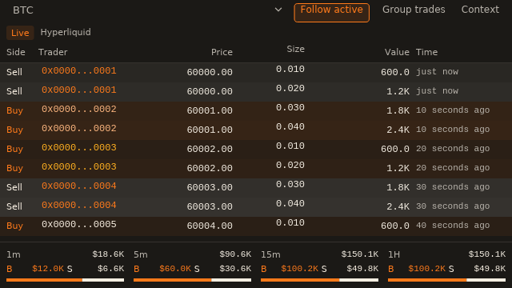
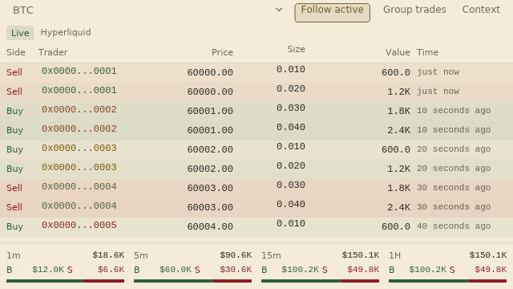
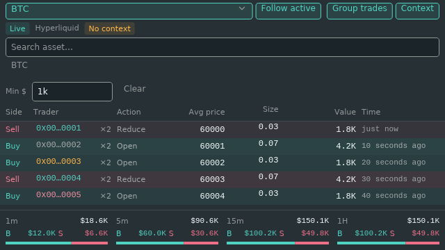
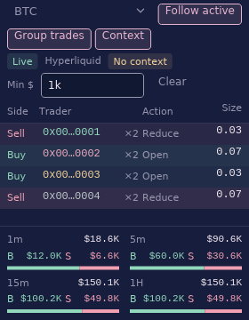

# Trade Feed design reference

[Design language](README.md) · [Feature behavior](../components/market-data-and-symbols.md#trade-feed)

The Trade Feed adopts the compact terminal language without changing its market
streams, aggregation, filters, wallet actions, or saved settings. Geometry stays
the same across themes; colors resolve from the active palette and actual pane
surface.

## Composition

| Element | Implemented treatment |
| --- | --- |
| Asset and toolbar | Asset selector, Follow active, Group trades, and Context use 24px controls and 12px labels; asset title is 13px. Selected controls retain an outline and subtle accent fill on hover and press. |
| Status | 11px text in 18px badges. Live, Waiting, Reconnecting, Unavailable, History gap, Rows held, and No context have explicit labels. Provider remains visible beside status. |
| Picker and minimum | 28px fields, 4px corners, 1px boundary, 2px focus outline within stable geometry. Invalid amounts retain the previous valid threshold and show an inline explanation. |
| Tape | Continuous 24px rows with 8px side insets; 12px data and 11px metadata. Header and rows share column definitions. Numeric data uses the configured monospace font and aligns right. |
| Direction | Explicit Buy/Sell text plus success/danger color. Notional-dependent row tint is bounded to 12%, and reduced further where necessary for legibility. |
| Identity | Theme-derived stable trader colors; a grouped count occupies its own fixed slot. Compact grouped addresses retain both prefix and suffix. Existing address-book labels and wallet actions remain available. |
| Summary | Pinned 1m/5m/15m/1H cells with totals, B/S amounts, and 4px ratio bars. Zero totals are neutral; one-sided activity fills only its actual side. |

At widths below 560px, the main tools move to a second line. Status labels wrap.
The tape preserves Side, Trader, Action when enabled, and Size/Notional; it adds
Price, Time, and Value only when their width budgets fit. Value is omitted when
Size already displays notional. The summary uses two columns below 600px and
four above it. In short panes, the controls and inline picker scroll to preserve
space for the header and a complete row where the available height permits.

Tooltips expose clipped values and explain grouping, context fallback, history
gaps, and held rows. Missing, waiting, unavailable, reconnecting, and filtered
empty states are distinguished using existing feed state. Summary totals remain
live when grouping, minimum filters, or wallet actions hold the visible tape.

## Native examples

These captures are drawn by iced's software renderer from the regression
fixture, using synthetic BTC trades and synthetic trader addresses. They contain
no account data, credentials, live market requests, or real wallet identities.
They show the widget body, without the surrounding pane title bar. The text
renderer uses the environment's default font; installed font fallback can vary.

Kerosene, 640 × 360:



Papertrade, 640 × 360:



Hyperliquid with picker, grouping, and context enabled, 640 × 360:



Papertrade UwU with grouping and context enabled, 280 × 360:



The context examples deliberately exercise the no-key fallback status. Synthetic
rows supply action labels to demonstrate the column; real Hyperliquid prints
without context show a dash.

## Implementation and checks

Shared recipes live in `src/helpers/ui/design.rs`. Trade Feed composition is
split between `src/trade_feed_views.rs` and its `controls`, `layout`, `rows`,
`colors`, and `summary` modules. State, update, persistence, and subscription
modules are unchanged.

The tests cover resolved foreground/background contrast across built-in and
bundled custom themes, stable trader colors across row intensities, optional
column budgets, real header/body alignment, instance-bound control messages,
wallet action reachability, footer pinning, and narrow empty/error/filter states.
Native renders exercise five themes at 280/320/400/640/1000px widths, including
grouping and the inline picker. Additional fixtures render at 125% and 150%
scale and with square corners.

To regenerate the optional native previews:

```sh
KEROSENE_TRADE_FEED_PREVIEW_DIR=/tmp/kerosene-trade-feed-preview \
  cargo test --bin kerosene trade_feed_views
cargo test --bin kerosene helpers::ui::design::tests
```

The existing 20px shared wallet action cell is retained within the 24px row.
Its global style and keyboard traversal for buttons remain separate work in the
application-wide rollout. Contrast checks resolve RGB pairs and preserve window
opacity; they cannot certify contrast against arbitrary content behind a
transparent window.
